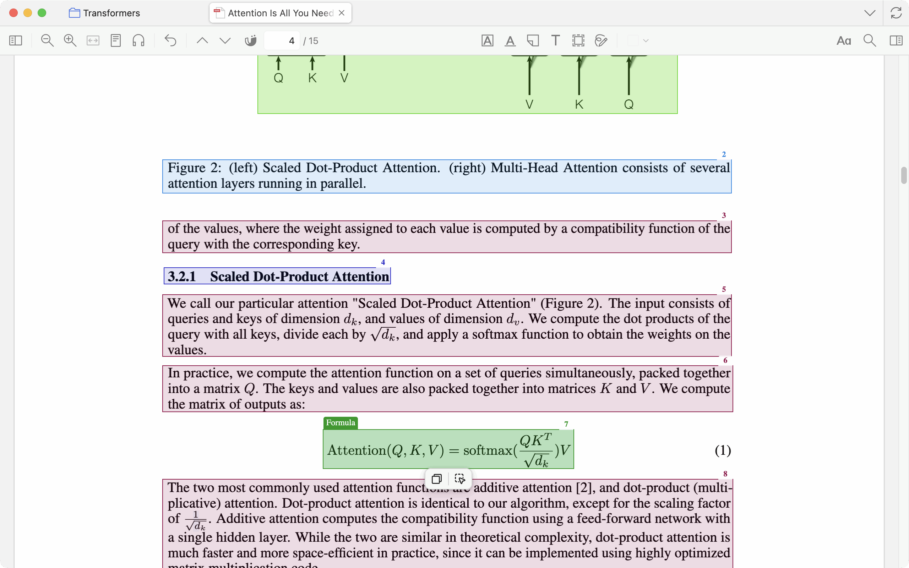
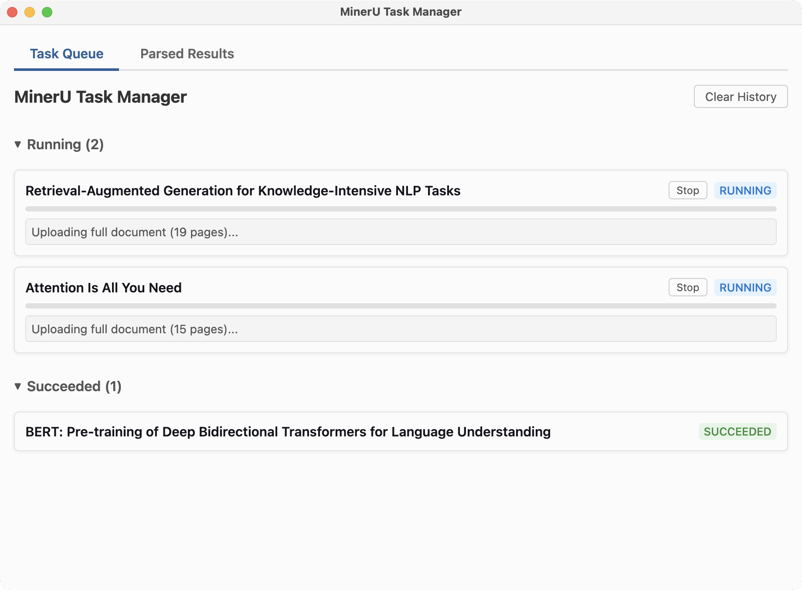

# MinerU for Zotero

[](https://github.com/dingzy53/mineru-for-zotero/releases/latest)
[](https://github.com/dingzy53/mineru-for-zotero/releases)
[](https://www.zotero.org)
[](LICENSE)

Parse PDFs in Zotero with [MinerU](https://mineru.net), copy text, tables and formulas straight from the PDF reader, and give AI agents clean Markdown.

A personal fork of [Asianfleet/mineru-for-zotero](https://github.com/Asianfleet/mineru-for-zotero) with its own plugin ID. See [License](#license).



## Features

- Parse one or more selected PDF attachments from the Zotero item list.
- Parse through the official online MinerU API or a self-hosted MinerU 4 server, and choose a parse tier (`flash`, `basic`, `standard`, `advanced`).
- Automatically handles long PDFs by requesting page ranges from MinerU and seamlessly merging the results (no local PDF tool required).
- Tracks processing jobs in the persistent **MinerU Task Manager** with live progress bars, status grouping (Running, Failed, Cancelled, Succeeded), history clearing, and one-click **Resume** for interrupted jobs.
- Automatically adds Zotero tags (`MinerU: Precise ✅`, `MinerU: Failed ❌`, `MinerU: Processing ⏳`) based on parse status. Tags sync to zotero.org and group libraries, so they can be turned off in the settings; the MinerU item column shows the status either way.
- Export results to an **Agent-friendly Sync Folder**, which automatically generates structured Markdown, images, and standard BibTeX metadata (`metadata.bib`) for each parsed PDF for seamless integration with downstream AI agents.
- Reuse an existing parse result, or reparse and replace it when needed.
- Show MinerU boxes in the Zotero PDF Reader.
- Switch between all boxes, hovered boxes, and off mode.
- Copy a single text, title, list, table, image caption, reference, formula, or other recognized box.
- Select multiple boxes with `Shift` or `Ctrl`, then copy them together in reading order.
- Copy the full parsed Markdown from the reader toolbar when no boxes are selected.
- Optionally save images from MinerU results into the local result folder.

## Requirements

- Zotero 9 or 10.
- A [MinerU API Key](https://mineru.net/apiManage/token) for online parsing (not needed for a local server without authentication).
- Optional for local parsing: a running MinerU 4 server, for example `mineru-kit api-server --host 127.0.0.1 --port 8000 --tier standard`.
- PDF attachments that are available on this computer.

## Installation

**Upgrading from 0.10.x or earlier:** those versions used the original plugin's ID. Remove the old plugin in **Tools → Plugins** first, then install this one. Your settings and parsed results are kept. Don't install this fork next to the original plugin.

1. Download `mineru-for-zotero.xpi` from the [latest release](https://github.com/dingzy53/mineru-for-zotero/releases/latest). In Firefox, right-click the link and choose **Save Link As…**, or Firefox tries to install it as a browser add-on.
2. In Zotero, open **Tools → Plugins**.
3. Click the gear icon, choose **Install Plugin From File…** and select the downloaded file.
4. Restart Zotero if it asks you to.

**Update or remove:** Zotero updates the plugin on its own. To check now, or to remove the plugin, use **Tools → Plugins**.

## Setup

1. Open **Edit → Settings → MinerU for Zotero** (**Zotero → Settings** on macOS).
2. Get your API Key from [MinerU API Token Management](https://mineru.net/apiManage/token) and enter it.
3. Choose the `API Type`:
   - `Online API` uses the official MinerU cloud and always parses at the `standard` tier.
   - `Local API` points at a self-hosted MinerU 4 server (default `http://127.0.0.1:8000`); enter its address and pick a `Parse Tier` (`flash`, `basic`, `standard`, or `advanced`).
4. Optional: enable `Save parsed result images` if you want images from MinerU results to be saved locally.

The API Key is stored only in local Zotero preferences.

## Parse a PDF

1. In the Zotero item list, select one or more PDF attachments.
2. Right-click the selection and choose `Parse PDF with MinerU`.
3. Wait until Zotero shows `MinerU parsing finished`.
4. Open the parsed PDF in the Zotero PDF Reader.

If a selected PDF already has a parse result, choose one of these options:

- `Use existing result`: keep the current result and use it in the reader.
- `Reparse and overwrite`: submit the PDF again and replace the result after parsing succeeds.

If parsing fails during replacement, the existing usable result is kept.

## Copy in the reader

1. Open a parsed PDF.
2. Click the `MinerU boxes` button in the PDF Reader toolbar.
3. Choose a mode:
   - `Show all boxes`
   - `Show only hovered box`
   - `Disable plugin features`
4. Hover over a box and click `Copy`.
5. For formulas, choose `Copy with $` or `Copy without $`.

For multi-box copying, hold `Shift` or `Ctrl` while clicking boxes. Then use the toolbar menu to copy the selected content or clear the selection. If no boxes are selected, the same copy button copies the full parsed Markdown.

## Local results and Task Manager

Open **Edit → Settings → MinerU for Zotero** and click `Open Data Folder` to view local parse results. The settings page also shows how many PDFs currently have usable results.

You can also open the **MinerU Task Manager** from **Tools → MinerU Task Manager** to view the real-time status of your parsing jobs, view error messages, and clear your history. Each running job shows a live progress bar. Stopping a job marks it `Cancelled` instead of failed: it keeps its resume data, adds no `MinerU: Failed ❌` tag, and can be resumed or retried later. PDF files larger than 200 MB are rejected on every parse path.



Parsing jobs survive Zotero restarts. If Zotero closes while a job is running, the job is marked as failed on the next start and shows a `Resume` button in the Task Manager. Resuming keeps every finished page-range part and only re-submits the missing parts, so a long parse does not have to start over. Transient network drops during polling and downloading reconnect automatically with backoff instead of failing the job.

The result folder contains the parsed Markdown, box data used by the reader, and optional images. External tools may read these files, but editing them is not recommended.

### Migrating results to another computer

All MinerU parse results are saved using portable `[libraryID]-[attachmentKey]` directory names (such as `1-ABCD1234/`), which match the persistent attachment keys synced across devices via Zotero Cloud Sync.

Parse results are stored in a `mineru-copy` folder inside your [Zotero data directory](https://www.zotero.org/support/zotero_data), so moving or copying the whole data directory carries them along. Results from older versions, which lived in the Zotero profile folder, are moved there automatically at startup.

To migrate only your parsed results without re-running parsing or consuming API quota:

1. **On the source computer:** Open **Edit → Settings → MinerU for Zotero** and click `Open Data Folder`. Copy the entire `mineru-copy` folder to an external drive or cloud storage.
2. **On the target computer:** Ensure Zotero has finished syncing your library items. Open **Edit → Settings → MinerU for Zotero**, click `Open Data Folder`, and paste the `mineru-copy` folder into that location.
3. Open the **MinerU Task Manager** (from **Tools → MinerU Task Manager** or the reader menu), switch to the **Parsed Results** tab, and click `Refresh`. All parsed results and reader overlay boxes will be immediately available.

### Agent-friendly sync folder

For AI workflows, you can configure an **Agent-friendly Sync Folder** in the settings. When enabled, MinerU for Zotero will automatically copy parsed results (Markdown + images) into a clean, flat directory structure named after the citation key and title (`[CitationKey] - Title/`). When two PDFs would share a folder name (for example a paper and its supplement), the attachment key is appended to keep them apart (`[CitationKey] - Title [ATTACHMENTKEY]/`).
It will also automatically generate a `metadata.bib` file containing the BibTeX metadata for each item. You can click `Sync All Results Now` in the settings to bulk-export all existing historical results to this folder.

This lets AI agents read the Markdown files directly. For searching, reading single sections and finding page numbers without knowing the folder layout, connect the agent to the [MCP server](#mcp-server-for-ai-agents) instead.

## MCP server for AI agents

The plugin serves an [MCP](https://modelcontextprotocol.io) endpoint from inside Zotero, on Zotero's own local server, so AI agents (Claude Code, and any other MCP client) can read your parsed papers. There is nothing separate to install or keep up to date: the tools ship with the plugin.

### Connect an agent

1. Open **Edit → Settings → MinerU for Zotero** and find **MCP Server (for AI agents)**.
2. Copy one of the two ready-made commands and run it in a terminal:

```bash
# Recommended: a small bridge that also works when Zotero starts after your agent (needs Node.js 18+)
claude mcp add mineru-for-zotero -e MINERU_ZOTERO_TOKEN=<token> \
  -- node "<Zotero data directory>/mineru-mcp/mineru-for-zotero-mcp.mjs"

# Direct HTTP connection
claude mcp add --transport http mineru-for-zotero http://127.0.0.1:23119/mineru-for-zotero/mcp \
  --header "Authorization: Bearer <token>"
```

Any MCP client that supports Streamable HTTP can use the endpoint with the token as a bearer token. The server speaks the stateless MCP 2026-07-28 protocol and the `initialize`-based 2025-03-26 … 2025-11-25 revisions. Responses are plain JSON: there is no SSE and no session.

An HTTP client connects once, when its session starts. If Zotero is not open at that moment, the tools are missing for the whole session. The bridge avoids this: it always starts, answers the tool list from a saved copy while Zotero is closed, and reaches Zotero as soon as it is running.

### Tools

| Tool                       | What it does                                                                                                                             |
| -------------------------- | ---------------------------------------------------------------------------------------------------------------------------------------- |
| `mineru_list_collections`  | Libraries and collections, as paths with keys.                                                                                           |
| `mineru_list_tags`         | Tags of a library.                                                                                                                       |
| `mineru_collection_status` | Which items of a collection are parsed, not parsed, or have no PDF, with word counts.                                                    |
| `mineru_search_items`      | Find items by title, creator, year, collection, tag, DOI and more.                                                                       |
| `mineru_get_outline`       | Heading tree, size and stored file path of a parsed paper.                                                                               |
| `mineru_read_section`      | One section as Markdown.                                                                                                                 |
| `mineru_search_in_paper`   | Paragraphs that contain a phrase, with context.                                                                                          |
| `mineru_locate_in_pdf`     | Physical page of a passage (precise results only).                                                                                       |
| `mineru_read_markdown`     | The full Markdown, in pages.                                                                                                             |
| `mineru_parse_pdf`         | Start a MinerU parse for a PDF without a result. Spends your MinerU quota; a PDF with a current result is skipped unless `force` is set. |
| `mineru_list_tasks`        | Parse tasks with status, progress and errors.                                                                                            |

A tool call answers within about 50 seconds. `mineru_parse_pdf` waits for the parse that long and otherwise answers `running`; follow it with `mineru_list_tasks`.

### Access and errors

- Every request needs the token from the settings pane. **Regenerate** replaces it and cuts off clients until you run the new command.
- Requests that carry an `Origin` header, which is to say requests from web pages, are rejected.
- The token is stored in Zotero's preferences and in your MCP client's configuration. It only works from this computer.

| Response                   | Meaning                                                                                                             |
| -------------------------- | ------------------------------------------------------------------------------------------------------------------- |
| `401`                      | The bearer token is missing or wrong. Copy the command again from settings.                                         |
| `403`                      | The request came from a web page (`Origin` header).                                                                 |
| `503`                      | **Enable MCP server** is unchecked in settings.                                                                     |
| Tools missing in the agent | Zotero was not running when an HTTP client connected. Reconnect (`/mcp` in Claude Code), or use the bridge command. |

### If you installed the earlier skill

Versions up to 0.11 shipped a `mineru-for-zotero-cli` skill with a Node CLI. It is replaced by the MCP server. Delete the `mineru-for-zotero-cli` folder from your agent's skill folder (for example `~/.claude/skills/`). The REST API it used is still there for scripts; see [Local Markdown query API](#local-markdown-query-api).

## Local Markdown query API

The local Markdown query API lets local external tools read Markdown parse results that MinerU for Zotero has already saved through Zotero's built-in local HTTP server. It reads existing local results, can submit a parse for an existing PDF attachment, and never opens a dialog or directly exposes the plugin data folder.

Main capabilities:

- Search candidate Zotero items and PDF attachments by title keywords.
- Read Markdown for a regular Zotero item or PDF attachment with `libraryID + key`.
- Query at `full`, `headings`, `section`, or `search` granularity, so external agents can inspect structure before reading a section or keyword context.
- `search` and `locate` queries match the text as a reader sees it: inline tags such as `<sub>` are ignored (`CO2` finds `CO<sub>2</sub>`), and a query may span a line break.
- Pass `attachmentKey` to select a specific PDF when a regular item has multiple PDF attachments.
- Return precise Markdown first; if precise output is unavailable but lite output exists, return lite Markdown and mark it in `result.mode`.
- Parse an attachment without any interactive prompt (skipping PDFs that already have a current result unless `force=true`), and list current parse tasks with their status, progress, and error text.

### Configuration

1. Start Zotero and make sure MinerU for Zotero is enabled.
2. Open **Edit → Settings → MinerU for Zotero**.
3. In `Local Query API`, enable `Enable local Markdown query API`.

The API has no token or other authentication of its own. It relies on Zotero's local HTTP server, which binds to `127.0.0.1` and rejects requests whose `Host` header is not local, so it is reachable only from this computer. Leave the API disabled unless you need it.

Zotero's local port is usually `23119`. If you changed Zotero's local server port, replace the port in the examples below with your actual port.

### HTTP examples

List libraries:

```shell
curl "http://127.0.0.1:23119/mineru-for-zotero/libraries"
```

List collections in a library:

```shell
curl "http://127.0.0.1:23119/mineru-for-zotero/collections?libraryID=1"
```

List tags:

```shell
curl "http://127.0.0.1:23119/mineru-for-zotero/tags?libraryID=1&limit=50"
```

Search candidate items by title and filters:

```shell
curl --get "http://127.0.0.1:23119/mineru-for-zotero/search" \
  --data-urlencode "libraryID=1" \
  --data-urlencode "title=retrieval augmented generation" \
  --data-urlencode "collection=AI" \
  --data-urlencode "parsedOnly=true"
```

Report which items of a collection are parsed:

```shell
curl --get "http://127.0.0.1:23119/mineru-for-zotero/status" \
  --data-urlencode "libraryID=1" \
  --data-urlencode "collection=AI" \
  --data-urlencode "includeSubcollections=true"
```

The response has `totals` (`items`, `parsed`, `notParsed`, `noPdf`) and one entry per regular item or standalone PDF in `items`: `key`, `title`, `year`, `firstCreator`, and `attachments`, each with `key`, `fileName`, `state` (`precise`, `lite`, `running`, `failed`, or `none`) and, when a result exists, `words`.

Read the full Markdown:

```shell
curl "http://127.0.0.1:23119/mineru-for-zotero/markdown?libraryID=1&key=ABCD1234"
```

Read only the heading hierarchy:

```shell
curl "http://127.0.0.1:23119/mineru-for-zotero/markdown?libraryID=1&key=ABCD1234&granularity=headings"
```

Read a specific section:

```shell
curl --get "http://127.0.0.1:23119/mineru-for-zotero/markdown" \
  --data-urlencode "libraryID=1" \
  --data-urlencode "key=ABCD1234" \
  --data-urlencode "granularity=section" \
  --data-urlencode "sectionPath=Introduction/Background"
```

Search Markdown and return surrounding paragraphs:

```shell
curl --get "http://127.0.0.1:23119/mineru-for-zotero/markdown" \
  --data-urlencode "libraryID=1" \
  --data-urlencode "key=ABCD1234" \
  --data-urlencode "granularity=search" \
  --data-urlencode "q=retrieval" \
  --data-urlencode "contextParagraphs=2"
```

Parse a PDF attachment (`POST` only; returns immediately and never opens a dialog):

```shell
curl -X POST "http://127.0.0.1:23119/mineru-for-zotero/parse?libraryID=1&key=ABCD1234"
```

The response is `{"status":"submitted","itemID":123,"key":"ABCD1234","submittedAt":1763100000000}`. Pass `attachmentKey` to pick one PDF when `key` is a regular item. `status` is one of:

- `submitted`: the parse was started; follow it through `/tasks`. A task whose `updatedAt` is older than `submittedAt` is the record of an earlier parse.
- `already-parsed`: a precise result made from the PDF as it is now already exists, so nothing was submitted and no MinerU quota was spent. Add `force=true` to parse again and replace the result.
- `already-running`: the attachment is being parsed; nothing was submitted.

List parse tasks:

```shell
curl "http://127.0.0.1:23119/mineru-for-zotero/tasks"
```

The response is `{"tasks":[...]}`. Each summary contains `id`, `attachmentID`, `libraryID`, `key`, `fileName`, `title`, `status`, `progress`, `detail`, `error`, `resumeAvailable`, `createdAt`, and `updatedAt`; absolute PDF paths are not exposed. `status` is one of `pending`, `running`, `succeeded`, `failed`, or `cancelled`.

Common parameters:

| Parameter               | Endpoint                                                       | Description                                                                |
| ----------------------- | -------------------------------------------------------------- | -------------------------------------------------------------------------- |
| `libraryID`             | `collections`, `tags`, `search`, `status`, `markdown`, `parse` | Zotero library ID. Personal libraries are usually `1`.                     |
| `parentKey`             | `collections`                                                  | Optional parent collection key.                                            |
| `title`                 | `search`                                                       | Title keyword used to find candidate Zotero items.                         |
| `creator`               | `search`                                                       | Creator/author substring to match.                                         |
| `collection`            | `search`, `status`                                             | Collection name or key to filter within a folder. Required for `status`.   |
| `includeSubcollections` | `status`                                                       | Also report items in the collection's subcollections (`true`).             |
| `tag`                   | `search`                                                       | Exact tag to filter.                                                       |
| `abstract`              | `search`                                                       | Abstract keyword to search.                                                |
| `publication`           | `search`                                                       | Journal or conference title to match.                                      |
| `citekey`               | `search`                                                       | Citation key to match (e.g. `vaswani2017attention`).                       |
| `doi`                   | `search`                                                       | DOI substring to match.                                                    |
| `itemType`              | `search`                                                       | Item type filter (e.g. `journalArticle`, `conferencePaper`).               |
| `since`                 | `search`                                                       | Date added filter (`YYYY-MM-DD`).                                          |
| `hasPdf`                | `search`                                                       | Filter items that have at least one PDF attachment (`true`).               |
| `parsedOnly`            | `search`                                                       | Filter items with ready MinerU parse results (`true`).                     |
| `sortBy`                | `search`                                                       | Sort by `dateAdded`, `dateModified`, `title`, or `year`.                   |
| `sortOrder`             | `search`                                                       | Sort direction (`asc` or `desc`).                                          |
| `limit`                 | `tags`, `search`                                               | Maximum number of records to return.                                       |
| `key`                   | `markdown`, `parse`                                            | Zotero regular item key or PDF attachment key.                             |
| `attachmentKey`         | `markdown`, `parse`                                            | Selects the target PDF attachment when a regular item contains PDFs.       |
| `force`                 | `parse`                                                        | Parse again even when a current result exists (`true`).                    |
| `granularity`           | `markdown`                                                     | `full`, `headings`, `section`, `search`, or `locate`. Defaults to `full`.  |
| `sectionPath`           | `markdown`                                                     | Heading path for `section` queries, for example `Introduction/Background`. |
| `includeSubsections`    | `markdown`                                                     | Extend section scope to same-level numbered subsections (`true`).          |
| `q`                     | `markdown`                                                     | Keyword used by `search` or `locate` queries.                              |
| `contextParagraphs`     | `markdown`                                                     | Number of context paragraphs around each `search` match.                   |

Common error codes:

- `api-disabled`: the local Markdown query API is not enabled in settings.
- `invalid-request`: a required parameter is missing or invalid; `/parse` also returns it for non-`POST` requests.
- `ambiguous-attachment`: the regular item has multiple PDFs; pass `attachmentKey`.
- `collection-not-found`: the `collection` search filter matches no collection key or name in the library; list them with `/collections`.
- `parse-result-not-found`: the target PDF has no usable parse result yet; parse it in Zotero or through `/parse` first.
- `section-not-found`: the section path does not match; run `granularity=headings` first to inspect exact paths.
- `missing-query`: `granularity=search` was used without `q`.

## Privacy and security

- **Online API:** the PDF is sent to MinerU for parsing. The plugin gets an upload link from `mineru.net`, uploads the file to MinerU's cloud storage, and downloads the result from MinerU's download server. MinerU's own terms and privacy policy apply.
- **Local API:** the PDF goes only to the server address you set.
- **API key:** stored in your local Zotero preferences and sent only to `mineru.net`.
- **Files:** results go to the `mineru-copy` folder in your Zotero data directory, and to the sync folder if you set one.
- **Local Markdown query API:** off by default. When on, it answers only on this computer (`127.0.0.1`) and has no token of its own.
- No telemetry. The plugin contacts nothing else.

## Troubleshooting

### API key not configured

Open the plugin settings page, enter your MinerU API Key, and try again.

### File access failed

Make sure the PDF is available locally. If the attachment is cloud-only or still syncing, open or download it in Zotero first.

### The reader says no parse result is available

Parse the PDF first. If you already parsed it, open the data folder from the settings page and confirm that the parsed result still exists.

### Boxes are not visible

Confirm that the toolbar mode is not set to `Disable plugin features`. If the PDF was parsed but still has no boxes, reparse it.

### Result download failed

The MinerU result download may be temporarily unavailable. Parsing automatically reconnects through short network drops; if the failure persists, try again later or reparse the PDF.

### A parse was interrupted (Zotero closed or crashed)

Open the Task Manager from **Tools → MinerU Task Manager**. Jobs that were running when Zotero closed are marked as failed and show a `Resume` button. Resume continues from the finished parts instead of re-submitting the whole PDF. This is especially useful for local parsing, where the MinerU service keeps the submitted parts between sessions.

## Development

Install dependencies:

```shell
npm install
```

Start development mode:

```shell
npm start
```

Run tests, checks, and build:

```shell
npm test
npm run lint:check
npm run build
```

## License

[AGPL-3.0-or-later](LICENSE).

- Copyright (C) Asianfleet: the original [MinerU for Zotero](https://github.com/Asianfleet/mineru-for-zotero).
- Copyright (C) 2026 Ding Zheng Yuan: modifications in this fork (see the git history for details).

This is a modified version of the original project, released under the same license. It is built on [zotero-plugin-template](https://github.com/windingwind/zotero-plugin-template) (AGPL-3.0). It is not affiliated with or endorsed by MinerU, OpenDataLab, Zotero, or the Corporation for Digital Scholarship.
